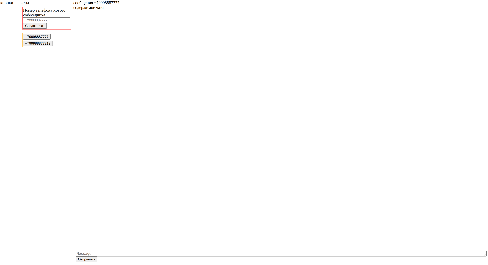

Для запуска сервера сначала делаем установку npm и зависимостей проекта - `npm i`

После этого запускаем vite сервер при помощи `npm run dev`

Для сборки используем `npm run build`, и после сборки можем запустить сервер с уже собранным приложением `npm run preview`

